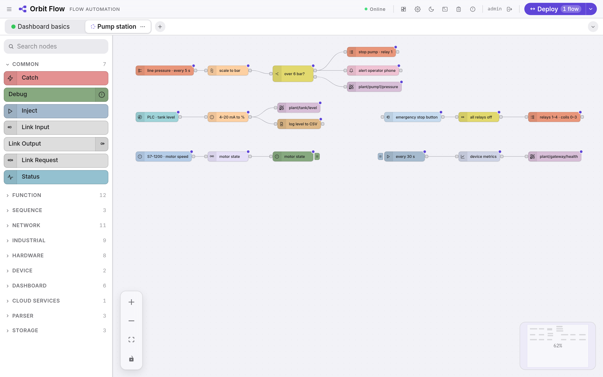
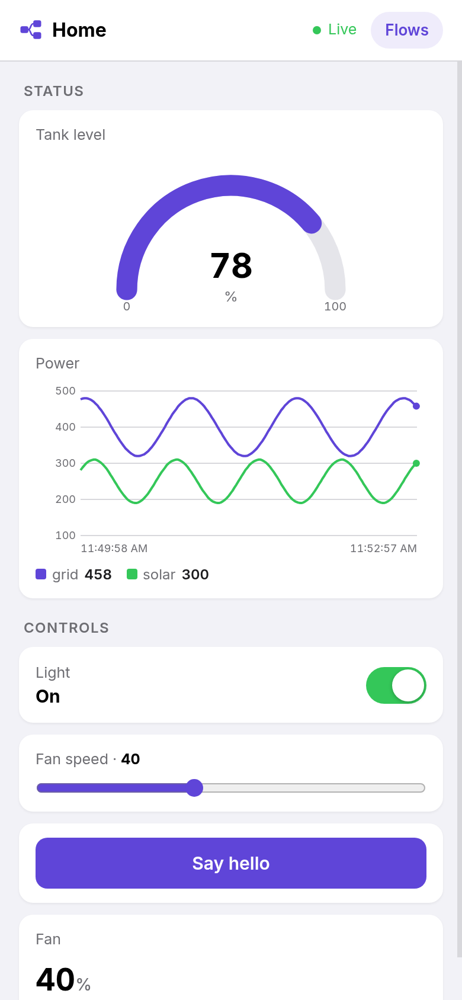

<p align="center">
  
</p>

<h1 align="center">Orbit Flow for Orbit OS</h1>

<p align="center"><b>Build industrial automation by wiring blocks in your browser — Modbus, OPC UA, S7 and MQTT, running on the device itself.</b></p>

An [Orbit OS](https://www.orbit-os.org/?ref=github-orbit-flow) app for visual automation: drag nodes onto a canvas, connect them and deploy. Read a Modbus register every 30 seconds, switch a relay when an input closes, publish a value over MQTT, show a gauge on your phone. If you know Node-RED, you know how it works: the same nodes, the same messages, the same Deploy. The flows run on the device, with no cloud service.

It is also a complete example of an Orbit OS app in Go, using the **GPIO, PWM, UART, I²C, SPI, system and mobile notification APIs** through the [Orbit OS Go SDK](https://github.com/OrbitOS-org/orbit-os-sdk-go).

Runs on Raspberry Pi, Arduino UNO Q and other ARM64 devices with Orbit OS (free Community Edition).

<p align="center">
  
  
</p>

## Features

- **Works like Node-RED** — the same node names and `msg.payload`, Deploy with *Full*, *Modified Flows* or *Modified Nodes*, Stop and Start Flows, flows in tabs with a live debug panel
- **Industrial protocols built in** — Modbus TCP and RTU, OPC UA, Siemens S7 and MQTT
- **The device's own hardware** — GPIO, PWM, I²C, SPI and serial ports (RS-232, RS-485, USB adapters); outputs go off when the flows stop
- **A dashboard for the phone** — gauges, charts, text, switches, sliders and buttons, updated live; viewer accounts can use it without changing the flows
- **Logic without code, or with it** — switch, change, trigger, filter, range, split, join, state machine; JavaScript, expressions or Go when you need them
- **Data in and out** — HTTP, TCP, UDP, JSON, XML, CSV, files on the device and push notifications to your phone
- **Ready-made examples** — from first steps to relay boards, energy meters and GPS, a click away in **+** → *Open…*

## Install

<p>
  <a href="https://store.orbit-os.org/app/orbit-flow?ref=github-orbit-flow"></a>
  &nbsp;
  <a href="https://marketplace.visualstudio.com/items?itemName=orbit-os.orbit-studio"></a>
</p>

**From the Orbit OS Store (recommended):** install [Orbit Flow](https://store.orbit-os.org/app/orbit-flow?ref=github-orbit-flow) on your device in one click.

**From source — recommended: [Orbit Studio](https://marketplace.visualstudio.com/items?itemName=orbit-os.orbit-studio) (VS Code):**

You need [VS Code](https://code.visualstudio.com/) with the Orbit Studio extension, **[Go](https://go.dev/dl/) 1.25 or newer** (`go` on your PATH) and, to build the editor, **[Node.js](https://nodejs.org/) 20 or newer**.

1. Clone the repository and build the editor:
   ```bash
   git clone https://github.com/OrbitOS-org/orbit-os-app-orbit-flow
   cd orbit-os-app-orbit-flow/frontend && npm install && npm run build
   ```
2. In VS Code, open **Orbit Studio** from the Activity Bar → **My projects** → **Open project** and pick the `orbit-os-app-orbit-flow` folder. Orbit Studio downloads the SDK, adds the development certificates and opens the project.
3. Choose your device in the device picker of the status bar (add it by its IP the first time).
4. Press **Run** to try it live against a device in Developer Mode, then **Deploy** to build, sign and install the `.orb`.

**Without Orbit Studio:** unpack the [SDK release](https://github.com/OrbitOS-org/orbit-os-sdk-go/releases) into `orbit-os-sdk-go/`, build the editor as above, then `go build ./cmd/orbit_flow` builds the binary — use Orbit Studio to package and sign the `.orb`.

## Getting started

1. Open the device portal at `http://<DEVICE_IP>`, sign in, and open **Orbit Flow** from the Launcher.
2. Create the administrator account on the first visit.
3. Drag an **Inject** node and a **Debug** node onto the canvas, connect them and press **Deploy**.
4. Click the button on the Inject node and watch the message arrive in the debug panel. For a dashboard, open the **Dashboard basics** example from **+** → *Open…* and press the dashboard button at the top of the editor.

## How it works

Each node runs on its own and passes messages to the nodes wired after it; Deploy saves the flows on the device and starts them again after a restart. The dashboard is a page of the app, built from the dashboard nodes of the running flows. The engine, the safe state of outputs, what the app keeps in its data folder and the code map are in [docs/how-it-works.md](docs/how-it-works.md).

## Development (Orbit Studio)

| Path | What |
|---|---|
| `cmd/orbit_flow/` | app entry point (`main.go`), the node groups built into the app (`groups.go`), `metadata.json` (manifest and permissions) |
| `cmd/orbit_flow/orb/icon.svg` | Launcher and Store icon |
| `internal/flow/`, `internal/server/`, `internal/api/` | flow engine, HTTP server and API |
| `internal/nodes/` | the nodes, one folder per group; `gpio`, `pwm`, `i2c`, `spi`, `serial` and `orbit` use the Orbit OS API |
| `internal/dashboard/` | the state of the dashboard |
| `frontend/` | the editor and the dashboard (Vue 3); `npm run build` writes them to `web/dist/`, which is built into the app |
| `examples/` | the example flows of **+** → *Open…*, one JSON file each |
| `orbit.project.json` | Orbit Studio project settings |

- **Recommended workflow:** in Orbit Studio, **My projects** → **Open project** (downloads the SDK into `orbit-os-sdk-go/`, which is not in the repository, and adds the development certificates), then **Run** or **Deploy** from the status bar.
- Build the editor (`frontend/`, `npm run build`) before the app: the app serves it from `web/dist/`, which is not in the repository.
- Run the tests with `go test ./...`.
- Development TLS certificates live in `cmd/certs/grpc/` and are never committed.

## Security

- The page listens on `127.0.0.1` only and is reached through the Orbit OS Launcher, at `http://<DEVICE_IP>/orbit-flow/`, behind the device login. It is not reachable directly from the network.
- The app takes a port in the reserved range 50000–60000 (starting at 52880) and moves to the next one when a port is taken.
- Orbit Flow has its own accounts on top of that (admin, editor, viewer); create the administrator account right after installing. Secrets of connections are stored encrypted in the app's data folder.
- The file nodes can only read and write inside the `files` folder of the app's data folder.
- Flows can open network connections and listen on ports (HTTP, TCP, UDP, MQTT). Whoever can edit flows can do that: give the editor role only to people you trust.
- Permissions used: `SystemService`, `AppHubService`, `UartService`, `GpioService`, `PwmService`, `I2CService`, `SpiService`, `MobileNotificationService`.

## Acknowledgments

- Orbit Flow is based on **[LOOPZE](https://github.com/loopzedev/loopze-edge)** by **Dennis Bleul**, an industrial flow automation tool written in Go (AGPL-3.0-or-later). The flow engine, the editor and the industrial protocol nodes come from LOOPZE; [NOTICE](NOTICE) lists what Orbit Flow changed.
- The editor uses the typefaces [Inter](https://github.com/rsms/inter) and [IBM Plex Mono](https://github.com/IBM/plex) (SIL Open Font License 1.1).

## Links

[App in the Store](https://store.orbit-os.org/app/orbit-flow?ref=github-orbit-flow) · [Orbit OS](https://www.orbit-os.org/?ref=github-orbit-flow) · [Getting started](https://www.orbit-os.org/getting_started.html?ref=github-orbit-flow) · [SDK reference](https://www.orbit-os.org/api-reference.html?ref=github-orbit-flow) · [Forum](https://forum.orbit-os.org/?ref=github-orbit-flow) · info@orbit-os.org

## License

AGPL-3.0-or-later — see [LICENSE](LICENSE) and [NOTICE](NOTICE). Orbit Flow is a modified version of LOOPZE, which sets this license: the source code of every version must stay available, and so must the source of any modified version that people use over a network.
